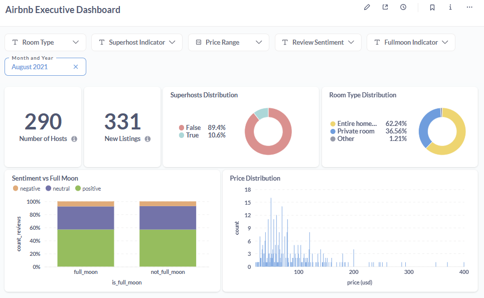

# Analytics Engineering with Airbnb


**Update 16/02/2025**:

> - Previously I made this using Snowflake as the data warehouse and Preset as the BI tool. Since I was using the free tier of Snowflake that only lasted for 1 month, all of the created pipelines were suspended.
> - So I decided to recreate the project using open source tools such as PostgreSQL and Metabase, running locally through Docker.

**Update 03/11/2026**:

> - Revamped the `Postgres Version` project to use `uv` (Python 3.13, managed by uv), a Dockerized PostgreSQL 17 instance on port `5433`, dbt v1.12, and Dagster 1.13. The local PostgreSQL 18 service is not used by this project.
> - dbt v2 (Fusion) is not yet supported for Postgres, so the project stays on dbt v1 until the Postgres adapter is available.

**Update 12/11/2026**:

> - Added a complete `BigQuery Version` of the same project: four BigQuery datasets (`raw`, `staging`, `analytics`, `snapshots`), dbt-bigquery, Dagster, and the same five Metabase dashboards / 66 cards.
> - BigQuery runs inside the free tier with explicit guardrails: a monthly budget alert, a 30 GiB/day query quota, and a 1 GiB per-query cap in dbt.
> - Local PostgreSQL remains only as the Metabase application database. All analytics data lives in BigQuery.

This project demonstrates a modern data stack implementation using Airbnb data. It includes data transformation pipelines using dbt, workflow orchestration with Dagster, and visualization with Metabase.

## Project Overview

This project showcases the end-to-end process of building a data analytics pipeline:

1. **Data Ingestion**: Loading raw Airbnb CSVs into a warehouse
2. **Data Transformation**: Using dbt to build staging, intermediate, dimension, fact, and mart models
3. **Workflow Orchestration**: Using Dagster to orchestrate the dbt asset graph
4. **Data Visualization**: Creating five Metabase dashboards with 66 saved questions

The repository contains two interchangeable versions:

- **`Postgres Version/`** — the original local stack, with PostgreSQL 17 as the warehouse.
- **`BigQuery Version/`** — the cloud port, with Google BigQuery as the warehouse and local PostgreSQL used only for Metabase metadata.

Both versions keep the same dbt model names, grains, tests, seeds, snapshots, Dagster asset graph, and Metabase dashboards.

## Two versions

| | Postgres Version | BigQuery Version |
| --- | --- | --- |
| Warehouse | PostgreSQL 17 in Docker (`airbnb` database) | Google BigQuery (`orbital-scene-422012-h0`) |
| Datasets / schemas | schemas `raw`, `staging`, `analytics`, `snapshots` | datasets `raw`, `staging`, `analytics`, `snapshots` in `asia-southeast2` |
| dbt adapter | `dbt-postgres` | `dbt-bigquery` |
| Local Docker | Postgres warehouse + Metabase + pgAdmin | Postgres app DB + Metabase + pgAdmin |
| Cost controls | local only | budget alert, daily query quota, per-query cap |
| Runbook | [`Postgres Version/docs/RUNBOOK.md`](Postgres%20Version/docs/RUNBOOK.md) | [`BigQuery Version/docs/RUNBOOK.md`](BigQuery%20Version/docs/RUNBOOK.md) |

## Technology Stack

| Layer | Postgres Version | BigQuery Version |
| --- | --- | --- |
| Language | Python 3.13 managed by `uv` | Python 3.13 managed by `uv` |
| Warehouse | PostgreSQL 17 | Google BigQuery |
| Transformation | dbt-core 1.12 + dbt-postgres | dbt-core 1.12 + dbt-bigquery |
| Orchestration | Dagster 1.13 | Dagster 1.13 |
| BI | Metabase 0.64 | Metabase 0.64 |
| Local infrastructure | Docker Compose | Docker Compose for the Metabase app DB only |

## Repository layout

```text
BigQuery Version/
├── pyproject.toml                # uv workspace + dbt-bigquery
├── profiles.yml                  # dbt-bigquery connection (gitignored)
├── profiles.yml.example          # committed placeholder profile
├── .env.example                  # committed placeholder configuration
├── compose.yaml                  # Metabase app DB + Metabase + pgAdmin
├── docker/init/                  # Creates only the metabase application database
├── data/raw/                     # Raw CSVs (gitignored; loaded with bq load)
├── airbnb_dbt/                   # BigQuery dbt project
│   ├── models/                   # staging, intermediate, analytics layers
│   ├── seeds/                    # Full-moon and review-topic seeds
│   ├── snapshots/                # SCD snapshots
│   └── tests/                    # Custom data tests
├── airbnb_dagster_project/       # Dagster orchestration
├── metabase/                     # definitions, filters, export, backups
├── scripts/                      # provisioning, loading, validation, Metabase
└── sql/                          # BigQuery data checks
```

```text
Postgres Version/
├── pyproject.toml                # uv workspace + dbt dependencies
├── uv.lock                       # Locked Python dependencies
├── compose.yaml                  # Dockerized PostgreSQL + Metabase + pgAdmin
├── docker/init/                  # Schema, raw CSV bootstrap, reporting grants
├── docker/pgadmin/               # pgAdmin server configuration
├── scripts/                      # Local helper scripts (live row-count watcher)
├── profiles.yml                  # Local dbt connection (gitignored)
├── airbnb_dbt/                   # dbt project for data transformations
│   ├── models/                   # staging, intermediate, analytics layers
│   ├── seeds/                    # Full-moon and review-topic seeds
│   ├── snapshots/                # SCD snapshots
│   └── tests/                    # Custom data tests
├── airbnb_dagster_project/       # Dagster project for workflow orchestration
├── sql/                          # Ad-hoc SQL data checks
└── data/raw/                     # Raw CSVs (gitignored; see data/raw/README.md)
```

## Data Models

`analytics` is the only BI-facing schema or dataset. `staging` holds ephemeral
source models, intermediate views, and seeds; `snapshots` holds the SCD
examples. The model set is identical in both versions.

### Staging Layer (ephemeral)

- `src_listings`: Raw listings data from Airbnb
- `src_hosts`: Raw hosts data from Airbnb
- `src_reviews`: Raw reviews data from Airbnb

### Intermediate Layer (views in `staging`)

- `int_listings_enriched`: Listings joined to hosts with price, age, minimum-night, and portfolio segments
- `int_reviews_deduped`: Exact-deduplicated reviews with sentiment scoring
- `int_review_topics`: One row per review and matched keyword topic

### Analytics Dimensions

- `dim_date`: Calendar spine for 2009-01-01 → 2021-12-31
- `dim_listings`: One row per listing with host attributes and derived segments
- `dim_hosts`: One row per host with host age and portfolio segment

### Fact Layer

- `fct_reviews`: Incremental review fact with a deterministic review key and 3-day lookback

### Mart Layer

- `mart_listing_performance`: One row per listing with review volume, recency, and sentiment
- `mart_host_performance`: One row per host with portfolio, price, and sentiment rollups
- `mart_market_monthly`: Month × room type supply and review activity
- `mart_price_bands`: Price band × room type distribution
- `mart_room_type_benchmark`: Room-type price and review benchmarks
- `mart_review_topics`: Month × keyword topic mentions
- `mart_executive_kpis`: Monthly KPI cards
- `mart_full_moon_reviews`: Full-moon sentiment novelty mart

## Getting Started

Choose one version. The two complete setup guides are:

- [`Postgres Version/docs/RUNBOOK.md`](Postgres%20Version/docs/RUNBOOK.md)
- [`BigQuery Version/docs/RUNBOOK.md`](BigQuery%20Version/docs/RUNBOOK.md)

### Prerequisites

- [uv](https://docs.astral.sh/uv/)
- Docker Desktop
- Google Cloud SDK (`gcloud` and `bq`) authenticated for the BigQuery version
- A GCP project with billing enabled for the BigQuery version

### Option A — Postgres Version

```powershell
git clone https://github.com/mcikalmerdeka/Analytics-Engineering-with-Airbnb.git
cd "Analytics-Engineering-with-Airbnb/Postgres Version"

# 1. Install Python 3.13 and dependencies
uv sync

# 2. Start PostgreSQL, Metabase, and pgAdmin
docker compose up -d

# 3. Install dbt packages and build/test
cd airbnb_dbt
uv run dbt deps --profiles-dir ..
uv run dbt build --profiles-dir ..

# 4. Start Dagster on port 3001
cd ..\airbnb_dagster_project
uv run dagster dev -p 3001
```

The first `docker compose up` loads the raw CSVs into the PostgreSQL `raw`
schema. Metabase is available at http://localhost:3000 and pgAdmin at
http://localhost:5050. Use the credentials in `Postgres Version/.env`.

### Option B — BigQuery Version

```powershell
git clone https://github.com/mcikalmerdeka/Analytics-Engineering-with-Airbnb.git
cd "Analytics-Engineering-with-Airbnb/BigQuery Version"

# 1. Create local configuration from the committed examples
Copy-Item .env.example .env
Copy-Item profiles.yml.example profiles.yml
# Edit .env and profiles.yml with your GCP project and a strong Metabase password.

# 2. Install Python 3.13 and dependencies
uv sync

# 3. Create datasets, the Metabase reader service account, and cost guardrails
.\scripts\provision_bigquery.ps1
.\scripts\set_bigquery_guardrails.ps1

# 4. Load the raw CSVs into BigQuery
.\scripts\load_raw_data.ps1

# 5. Build and test dbt
cd airbnb_dbt
uv run dbt deps --profiles-dir ..
uv run dbt build --profiles-dir ..
cd ..

# 6. Start the Metabase application database stack
docker compose up -d

# 7. Provision Metabase, seed cards/dashboards, and add filters
uv run python scripts\setup_metabase.py
uv run python scripts\seed_metabase.py
uv run python scripts\add_dashboard_filters.py

# 8. Start Dagster on port 3001
cd airbnb_dagster_project
uv run dagster dev -p 3001
```

BigQuery details:

- Project: `orbital-scene-422012-h0`
- Location: `asia-southeast2`
- Datasets: `raw`, `staging`, `analytics`, `snapshots`
- Expected raw counts: 17,499 listings, 14,111 hosts, 410,284 reviews
- Expected full build: `PASS=126 WARN=0 ERROR=0 SKIP=0 NO-OP=5 TOTAL=131`
- Expected tests: `PASS=107`
- Expected Metabase content: 5 dashboards, 66 cards, 23 filters / 189 mappings

## Reset and reload

### Postgres Version

The Docker init scripts only run when the database volume is empty. To reload
the raw data from scratch:

```powershell
cd "Postgres Version"
docker compose down -v
docker compose up -d
```

### BigQuery Version

BigQuery is not reset by deleting Docker volumes. Reload the raw tables and
rebuild dbt instead:

```powershell
cd "BigQuery Version"
.\scripts\load_raw_data.ps1

cd airbnb_dbt
uv run dbt build --profiles-dir ..
```

To restore Metabase content, restore an application-database backup; the
BigQuery warehouse is not touched:

```powershell
cd "BigQuery Version"
.\scripts\restore_metabase.ps1 -DumpFile .\metabase\backups\<timestamp>.dump -Force
```

> **dbt v2 note:** dbt v2 (formerly Fusion) does not yet support Postgres. The
> Postgres version therefore uses dbt v1 (`dbt-core` 1.12 + `dbt-postgres`).
> The BigQuery version uses `dbt-bigquery` on the same dbt-core line.

## Workflow Orchestration

Both versions use Dagster to orchestrate the dbt project:

1. The warehouse is loaded (Docker init for Postgres, `bq load` for BigQuery)
2. Dagster materializes the dbt assets with `dbt build`
3. The daily schedule is available but stopped by default
4. Metabase reads only the `analytics` schema/dataset

The asset graph contains 22 assets (18 models, 2 seeds, 2 snapshots), with dbt
tests exposed as asset checks.

## Data Visualization



Metabase reads only `analytics`. Five dashboards are modeled as dbt exposures:

- **Executive Overview** (`executive_overview`): KPI cards, supply and host growth, review volume, room mix, and sentiment trend.
- **Supply and Pricing** (`supply_pricing`): price distribution, room-type benchmarks, minimum-night segments, and superhost pricing.
- **Guest Experience** (`guest_experience`): review volume and seasonality, sentiment, and keyword topic mentions.
- **Host Portfolio** (`host_portfolio`): portfolio concentration, professional host segments, and superhost performance.
- **Listing Explorer** (`listing_explorer`): one-row-per-listing drill-down table.

The BigQuery version connects Metabase with a dedicated read-only service
account that can read `analytics` but cannot query `raw`, `staging`, or
`snapshots`.

## Project Workflow

1. Raw Airbnb CSVs are loaded into the chosen warehouse
2. dbt transforms the data into staging, intermediate, dimension, fact, and mart models
3. Dagster orchestrates the dbt asset graph
4. Metabase provides interactive dashboards for analysis

## Contributing

Contributions are welcome! Please feel free to submit a Pull Request.

## License

This project is open source and available under the [MIT License](LICENSE).
